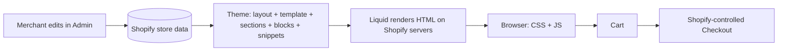

# Master Shopify for Dev

A developer-first Shopify learning and reference system: from "what is a product variant?" to production architecture for client projects.

> **Source policy.** Technical claims are verified against current official Shopify documentation (shopify.dev). The 109-page beginner PDF supplies the merchant/business layer only. General engineering advice is labeled as such. See [Verification legend](#verification-legend).

---

## What is Shopify?

**Shopify** is a hosted commerce platform. Shopify runs the servers, database, checkout, payments plumbing, and admin. You do not deploy a server for a standard store.

Technically, Shopify gives you:

1. **A data layer**: products, variants, collections, customers, orders, inventory, discounts, content.
2. **A rendering layer**: themes (Liquid + HTML/CSS/JS) that Shopify renders server-side into storefront pages.
3. **An API layer**: GraphQL (Admin and Storefront) for reading and writing that data from outside.
4. **An extension layer**: apps, theme app extensions, checkout extensions, and Shopify Functions for behavior the theme cannot or should not own.
5. **A checkout** that Shopify controls. Themes do not render it.

## What does a Shopify developer actually build?

| You build | Where it runs | Typical work |
|---|---|---|
| **Theme code** | Shopify renders it (Liquid) + the browser (CSS/JS) | Sections, blocks, snippets, templates, storefront behavior |
| **Apps** | Your server + Shopify admin | Integrations, admin tools, webhooks, background jobs |
| **Extensions** | Shopify-hosted surfaces | App blocks/embeds, checkout UI, Functions |
| **Headless storefronts** | Your own frontend host | Custom frontend on the Storefront API |

## How the storefront works (30-second version)



Full treatment: [03 Storefront Architecture](03-storefront-architecture.md).

## Theme developer vs app developer vs headless developer

| | Theme developer | App developer | Headless developer |
|---|---|---|---|
| Owns | Storefront markup and UI | Logic needing a server, private data, or Shopify-hosted extension points | Entire frontend |
| Languages | Liquid, HTML, CSS, JS | Node/Ruby/etc., GraphQL, extension frameworks | JS framework + Storefront API |
| Private API access | **No** | Yes (server-side) | Server-side only |
| Maintenance | Low to medium | Medium | High |

Decision detail: [33 Theme vs App vs Headless](33-theme-vs-app-vs-headless.md) and [34 Where Do I Put This?](34-where-do-i-put-this.md).

## Prerequisites

- 🟢 Working HTML, CSS, and JavaScript (DOM, events, `fetch`).
- 🟢 Comfort with a terminal and Git basics.
- Helpful: you have built WordPress/WooCommerce themes. [01 Mental Model](01-shopify-mental-model.md) maps those concepts to Shopify and calls out where the analogy breaks.

## Difficulty levels

🟢 Beginner · 🟡 Intermediate · 🟠 Advanced · 🔴 Expert

## Learning path

```
🟢 Understand Shopify (01, 02)
 ↓
🟢 Understand the storefront (03, 04)
 ↓
🟢 Learn Liquid (05) → 🟡 Data model (06)
 ↓
🟡 Sections & schema (07) → 🟡 Theme development (08) → 🟡 HTML/CSS/JS (09)
 ↓
🟡 CLI + Git (10) → 🟡 Products/collections/cart (11)
 ↓
🟡 Metafields & metaobjects (12)
 ↓
🟠 Storefront API → Admin API → GraphQL → Webhooks (13–16)
 ↓
🟠 Apps → Theme app extensions (17–18)
 ↓
🔴 Checkout extensibility → Functions → Headless (19–21)
 ↓
🟠 Performance, SEO, accessibility, security, debugging, testing (22–27)
 ↓
🔴 Deployment & production architecture (28–29)
 ↓
Projects, interviews, cheat sheets (30–32)
```

## Project roadmap

| # | Project | Level |
|---|---|---|
| 1 | Simple storefront customization | 🟢 |
| 2 | Custom homepage theme | 🟡 |
| 3 | Custom product page | 🟡 |
| 4 | Collection experience | 🟡 |
| 5 | AJAX cart drawer | 🟡 |
| 6 | Predictive search | 🟡 |
| 7 | Metafield-driven product experience | 🟡 |
| 8 | Metaobject-driven content system | 🟠 |
| 9 | Theme app extension | 🟠 |
| 10 | Shopify API integration | 🟠 |
| 11 | Custom Shopify app | 🟠 |
| 12 | Production-ready storefront | 🔴 |

## Quick navigation and build status

✅ = written in this release · 🚧 = planned (outline in [00 Roadmap](00-roadmap.md))

| Doc | Status |
|---|---|
| [00 Roadmap](00-roadmap.md) | ✅ |
| [01 Shopify Mental Model](01-shopify-mental-model.md) | ✅ |
| [02 Commerce Foundations](02-commerce-foundations.md) | ✅ |
| [03 Storefront Architecture + How a Page Works](03-storefront-architecture.md) | ✅ |
| [04 Theme Architecture](04-theme-architecture.md) | ✅ |
| 05 Liquid | 🚧 |
| 06 Shopify Data Model | 🚧 |
| 07 Sections and Schema | 🚧 |
| 08–09 Theme development, HTML/CSS/JS | 🚧 |
| [10 Shopify CLI + Git](10-shopify-cli-git.md) | ✅ |
| 11–32 (cart, metafields, APIs, apps, checkout, Functions, headless, performance, SEO, a11y, security, debugging, testing, deployment, projects, interviews, cheat sheets) | 🚧 |
| [33 Theme vs App vs Headless](33-theme-vs-app-vs-headless.md) | ✅ |
| [34 Where Do I Put This?](34-where-do-i-put-this.md) | ✅ |
| [source-analysis.md](source-analysis.md) | ✅ |
| [legacy-and-outdated-shopify.md](legacy-and-outdated-shopify.md) | ✅ |
| [verification-log.md](verification-log.md) | ✅ |

## Recommended learning sequence

1. Read 01 → 04 in order. Do not skip 03; every later chapter depends on it.
2. Create a development store and run `shopify theme dev` (chapter 10) while reading 04.
3. Work through Liquid with a real theme open next to you.
4. Do not touch APIs until you can explain, without notes, how `/products/example-product` becomes HTML.

## Verification legend

| Marker | Meaning |
|---|---|
| ✅ **Verified** | Checked against current official Shopify docs on 2026-10-06. Source cited. |
| ⚠️ **Verify** | From general knowledge, a non-official source, or version-sensitive. Confirm on shopify.dev before relying on it. |
| 🏛️ **HISTORICAL** | Described because old tutorials still use it. Not current practice. |
| 📘 **Engineering** | General software-engineering recommendation, not a Shopify fact. |
